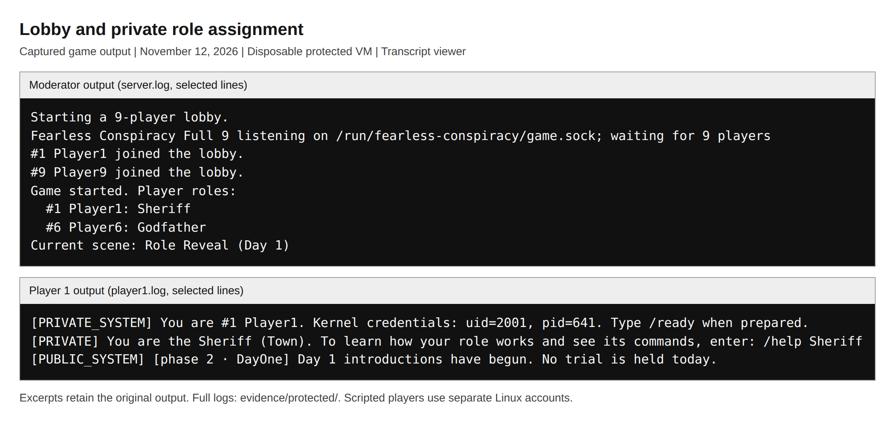
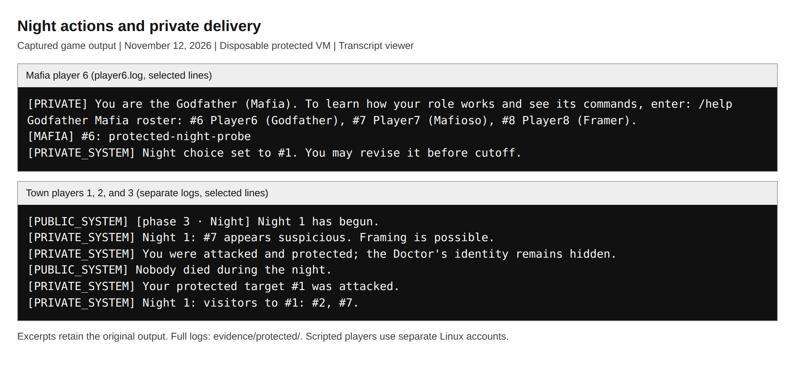
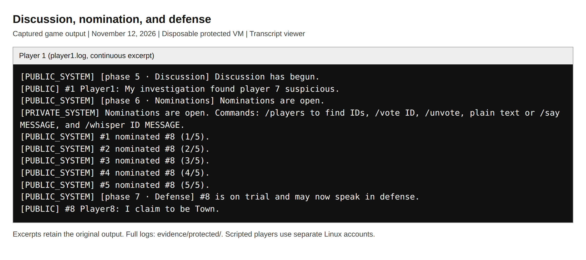
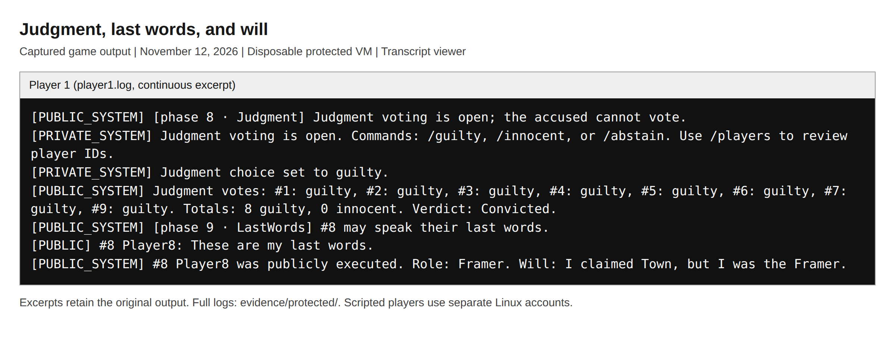
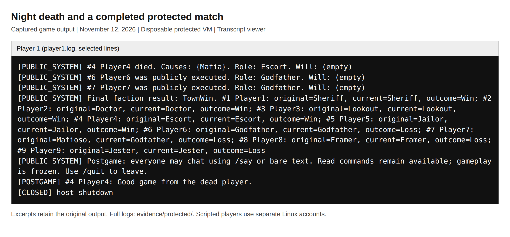
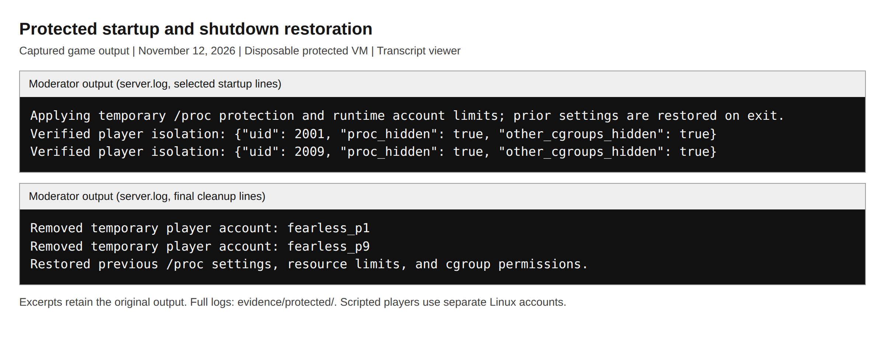

# Mitchell Bialecki

CSE 536 - Fearless Conspiracy: Linux Isolation

November 12, 2026

Report draft: The two peer-feedback paragraphs will be completed after the Canvas discussion and peer reviews.

## Introduction

Fearless Conspiracy is my text-based social deduction game written in Rust and inspired by Town of Salem. It supports 3-9 players. Town players try to identify and eliminate the Mafia, Mafia players try to eliminate Town, and the Jester tries to get publicly executed. Each player runs a separate client process under a different Linux account. The communications library is contained in one file, `src/comm.rs`. Its main API includes `ServerTransport::bind`, `ClientTransport::connect`, `send`, `recv_timeout`, `send_to`, `send_group`, and `broadcast`, along with `close` and `shutdown_gracefully`. For this project, I kept the original socket transport and added Linux isolation to protect private activity and limit resource abuse.

## Original communications primitive

Project 1 used Unix-domain stream sockets between the clients and a central server on the same Linux machine. Since a stream socket carries bytes rather than separate messages, the library puts a four-byte big-endian length before each JSON message. It handles partial reads and writes and rejects empty or oversized frames before allocating the payload buffer. The maximum payload is 64 KiB. Reader and writer threads allow multiple connections to communicate concurrently, while the server applies game commands in sequence. A private reply goes to one peer, Mafia or jail chat goes to selected peers, and a public announcement goes to everyone. Group delivery is implemented as individual sends to each recipient. Bounded queues and timeouts help handle slow or malformed connections. The transport obtains the client's UID and PID from Linux peer credentials instead of trusting a claimed identity.

## New isolation mechanisms

The problem I focused on was whether a player could learn who received private messages without reading those messages. In a controlled test, public lobby joins let a Town account map server connection threads to players. Watching the threads' context-switch counters during quiet Mafia chat then exposed the recipient group. The protected launcher, `scripts/protected-server.py`, now applies `hidepid=2` so separate player accounts cannot read the server metadata used by that test. It also restricts access to other players' cgroup statistics. Each player account receives a systemd user slice with a 25% quota of one CPU, a 192 MiB memory soft limit, a 256 MiB hard limit, no swap, and a 64-task limit. The transport admits only registered player UIDs whose clients belong to the expected limited slice.

Protected mode is now the default. The launcher creates private player accounts, checks permissions and the kernel's actual limits, and starts the game under a separate account without root credentials or capabilities. It saves the previous procfs settings, resource overrides, and cgroup permissions before changing them. On shutdown it stops the game, removes automatically managed player accounts, and restores those settings. Existing accounts supplied explicitly are preserved. A root-only recovery record allows the next protected launch, or `sudo ./server --restore`, to finish cleanup after forced termination. The locked server account and staged executables are retained for reuse.

<!-- pagebreak -->

## Testing and results

I checked the finished version on November 12, 2026, using disposable QEMU VMs with Linux 7.0.0-42-generic and QEMU 10.2.1. Both experiments used nine player accounts with UIDs distinct from the server's. The visibility experiment randomized roles; the protected gameplay experiment used predictable roles and manual phases so its actions could be checked reliably. The VMs had no network adapter, disk, or host filesystem share. Root controlled the experiments, but observations and stress workloads ran under player accounts. The recorded hashes match the tested binaries and guest scripts, and the host's procfs mount was unchanged.

The visibility experiment reproduced the issue before testing the fix. All eight normal-visibility windows matched their expected recipient sets: three Mafia-chat windows, two jail-chat windows, one private reply, and two idle controls. With `hidepid=2`, all eight corresponding windows lacked the server metadata needed for the inference. Missing metadata was recorded as unavailable, not as an empty recipient set. Re-enabling visibility produced six correct recovery windows without changing the roles. All 22 checks passed. Authorized participants still received private messages, while the Town observer received none of the secret probe text. These results show that the restriction blocked the measured thread-activity channel.

All 104 checks in the protected-startup experiment passed. A three-second CPU workload increased the player's throttled-period counter from 3 to 39; total slice CPU usage increased by about 0.912 seconds during the measured interval. A process-creation stressor stopped after creating 59 children because the 64-task limit also counts existing tasks. A 320 MiB allocation activated the memory soft limit. To test the hard cap separately, the controller temporarily disabled the soft throttle inside the test VM, kept the 256 MiB hard cap, and restored the soft limit afterward. The stressor was killed and the OOM-kill counter increased from zero to one. The server and all nine client processes stayed running, and the same match later reached a Town victory.

Cleanup was tested after normal shutdown, Ctrl+C, SIGTERM, SIGHUP, invalid game options, and failure partway through isolation setup. The tests checked restoration of nondefault procfs options, administrator resource limits, cgroup ownership and permissions, and an existing session. An unrelated CPU-weight override and an unrelated account were preserved. After SIGKILL prevented immediate cleanup, `sudo ./server --restore` stopped the orphaned game and restored the saved settings. Local checks also passed 80 Rust tests, 26 launcher policy tests, 13 wrapper tests, formatting, Clippy, the release build, and a five-client smoke game. The smoke game used the same-account development mode; the VM runs supplied the separate-user evidence.

## Feedback received from classmates

Pending classmate responses. The Canvas post describes the game, socket library, thread-activity issue, and new protections. It asks classmates to assess security, crash robustness, and the usefulness of the API. Once responses are available, this paragraph needs a concrete observation, what it taught me, and the change or test that followed. My own test results do not replace feedback from another student.

<!-- pagebreak -->

## Gameplay: joining and night actions

These new screenshots show a transcript viewer displaying output captured from the finished protected version. The players were scripted under separate Linux accounts. The excerpts retain the original output; full logs are included in `evidence/protected/`. No gameplay screenshots from Project 1 were reused.

Figure 1. Players join the nine-player lobby, and player 1 privately receives the Sheriff role with UID 2001. The moderator can see the role list, so that console must remain private during normal play.

Figure 2. The Mafia client receives its group-chat probe while separate Town clients receive investigation, protection, and Lookout results. The test also checks that the Town observer does not receive the Mafia probe text.

<!-- pagebreak -->

## Gameplay: voting and execution

Figure 3. Public discussion leads to five nominations of player 8, meeting the majority threshold with nine living players. The game enters Defense and the accused player speaks.

Figure 4. Eight eligible players vote guilty, the accused gives last words, and the execution reveals the Framer role and saved will. Public announcements and phase changes continue to work with isolation enabled.

<!-- pagebreak -->

## Gameplay: finishing the match and cleaning up

Figure 5. A night death is announced, the remaining Mafia members are executed, and the match reaches `TownWin`. A dead player can still participate in postgame chat before shutdown.

Figure 6. The launcher reports its isolation checks before play and removes temporary players after the completed match. Its final message confirms restoration; the VM tests separately compare the resulting settings with their saved values.

<!-- pagebreak -->

## Setup, API, and reproducibility

The README lists dependencies, file purposes, the complete communications API, and gameplay instructions. Build as a normal user with `cargo build --locked --bins`, then run `sudo ./server --players 5` in a dedicated Ubuntu/systemd VM with cgroup v2. The moderator privately distributes each account's credentials. Players log into their assigned accounts and run the staged client printed by the launcher. The lobby waits until every selected player has connected and entered `/ready`. Same-account development requires `./server --unprotected`.

Queued delivery does not mean a player has read the message. `TransportLimits` configures queues, timeouts, permissions, and admission. Run `bash scripts/check.sh` for code checks and `bash scripts/smoke-game.sh` for the local smoke game. `scripts/run-proc-visibility-vm.py` runs the visibility experiment, or the protected experiment with `--protected-launcher`. The README gives its dependencies and commands. The archive includes measurements, transcripts, run records, and a SHA-256 file manifest.

## Limits of the results

The inference used serial joins and quiet, controlled traffic, not arbitrary overlapping messages or simultaneous joins. Blocking this channel does not prove all timing channels or crash bugs are gone. Root, the server UID, and procfs-exempt groups remain outside the boundary. Memory caps can kill processes in the offending player's slice. SIGKILL requires recovery. The test kernel supported basic cgroup permissions rather than extended ACL entries; restoration checked its permissions, ownership, and setgid bit.

## References

Linux kernel, "The /proc Filesystem": https://www.kernel.org/doc/html/latest/filesystems/proc.html#mount-options. Documentation for `hidepid` and the group exemption.

Linux kernel, "Control Group v2": https://www.kernel.org/doc/html/latest/admin-guide/cgroup-v2.html. Documentation for CPU, memory, and task controls.

systemd, "systemd.resource-control" and "systemctl": https://www.freedesktop.org/software/systemd/man/latest/systemd.resource-control.html and https://www.freedesktop.org/software/systemd/man/latest/systemctl.html. Documentation for resource settings and runtime overrides. Reported results come from the included project evidence.

## What I learned

I learned that private message routing is only part of keeping information private. My original library sent Mafia chat to the right players, but the operating system exposed activity that could reveal those recipients. Restricting that metadata blocked the demonstrated inference while keeping authorized messages working. I also learned to verify the kernel's applied limits and to test the memory soft and hard limits separately. Finally, adding protection means taking responsibility for its lifecycle. Cleanup should restore the settings that were there before the game, preserve unrelated configuration, and leave enough information to recover when normal cleanup cannot run.

## Separate section: Feedback I gave other students

Pending the actual peer-review record. This section will describe the classmates' projects reviewed, whether I read the code, ran it, or joined a game, and the specific security or robustness feedback I gave. It will distinguish tests I actually performed from suggestions based on reading. The assignment recommends roughly twice the effort needed to obtain useful feedback on my own project. This section stays separate and at the end of the report so the completed review work can be assessed on its own.
